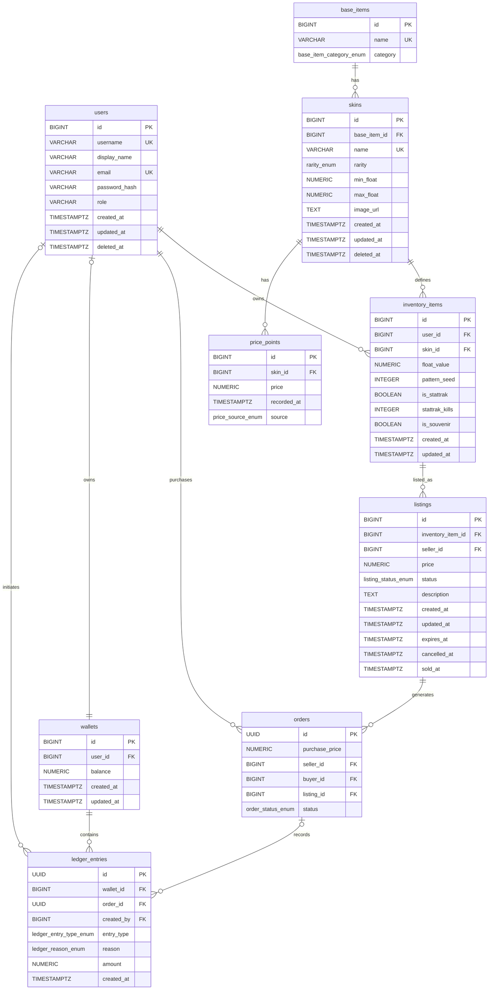

# CS2 MARKETPLACE — Entity Relationship Diagram

## 1. Overview

This document defines the database architecture for the CS2 Marketplace.

The marketplace supports:
- User and administrator accounts.
- CS2 skin catalogue management.
- Individual skin ownership and inventory.
- Skin listings and purchases.
- Simulated wallet balances.
- Financial transaction history.
- Historical skin price tracking.

The initial implementation uses a platform-wide virtual currency. No real-money payments or currency conversions are supported.

---

## 2. Entity Relationship Diagram



---

## 3. PostgreSQL ENUM Definitions

### 3.1 Base Item Category

```sql
CREATE TYPE base_item_category_enum AS ENUM (
    'firearm',
    'knife',
    'gloves'
);
```

### 3.2 Skin Rarity

```sql
CREATE TYPE rarity_enum AS ENUM (
    'Consumer Grade',
    'Industrial Grade',
    'Mil-Spec Grade',
    'Restricted',
    'Classified',
    'Covert',
    'Extraordinary',
    'Contraband'
);
```

### 3.3 Listing Status

```sql
CREATE TYPE listing_status_enum AS ENUM (
    'active',
    'sold',
    'cancelled',
    'expired'
);
```

### 3.4 Order Status

```sql
CREATE TYPE order_status_enum AS ENUM (
    'pending',
    'completed',
    'cancelled',
    'failed'
);
```

### 3.5 Ledger Entry Type

```sql
CREATE TYPE ledger_entry_type_enum AS ENUM (
    'debit',
    'credit'
);
```

### 3.6 Ledger Reason

```sql
CREATE TYPE ledger_reason_enum AS ENUM (
    'purchase',
    'refund',
    'giveaway',
    'adjustment'
);
```

### 3.7 Price Source

```sql
CREATE TYPE price_source_enum AS ENUM (
    'synthetic',
    'external',
    'manual'
);
```

---

## 4. Entity Responsibilities

### 4.1 users

Stores all registered marketplace accounts, including administrators.

**Important decisions:**
- Administrators and ordinary users share the same table.
- The `role` column distinguishes users from administrators.
- New accounts default to the `user` role.
- Only authorized administrators can promote accounts.
- `username` and `email` are unique.
- `display_name` does not need to be unique.
- `deleted_at` supports soft deletion.
- Soft-deleted usernames and email addresses remain reserved.
- Historical orders and ledger entries must remain available after account deletion.

### 4.2 base_items

Stores the base CS2 items.

Examples:
- AK-47
- AWP
- Karambit
- Sport Gloves

**Important decisions:**
- `name` must be unique.
- `category` identifies the item category.
- No soft deletion.
- No timestamps are required.
- New CS2 items can be added through ordinary INSERT operations rather than modifying an ENUM.

### 4.3 skins

Stores catalogue definitions of CS2 skins.

Examples:
- AK-47 | Redline
- AWP | Asiimov
- Karambit | Doppler

**Important decisions:**
- Each skin belongs to exactly one base item.
- `base_item_id` references `base_items.id`.
- `name` must be unique.
- `rarity` uses `rarity_enum`.
- `min_float` and `max_float` describe the possible float range of that skin.
- `image_url` is nullable.
- `deleted_at` supports soft deletion.
- Retired skins should be restored using their existing records rather than recreated.

### 4.4 inventory_items

Represents an actual individual skin owned by a user.

This is different from the `skins` catalogue.

**Important decisions:**
- Each inventory item belongs to exactly one user.
- Each inventory item references exactly one skin.
- `float_value` stores the actual float of the individual item.
- `pattern_seed` stores the individual item's pattern seed.
- `is_stattrak` identifies StatTrak items.
- `stattrak_kills` stores the StatTrak kill count.
- `is_souvenir` identifies Souvenir items.
- Wear condition is derived from `float_value`, not stored separately.
- Sticker support and Souvenir-specific metadata are postponed.
- `created_at` and `updated_at` are included.
- Ownership changes preserve the same inventory item ID.

### 4.5 listings

Stores items that users offer for sale.

**Important decisions:**
- `inventory_item_id` references the listed inventory item.
- `seller_id` references `users.id`.
- `price` stores the seller's current asking price.
- `status` represents the listing lifecycle.
- `description` is optional.
- Custom listing images are not supported initially. The catalogue image is used instead.
- Listing price history is not required initially.
- `expires_at` is nullable.
- `cancelled_at` records when the seller cancels a listing.
- `sold_at` records when a listing is successfully sold.
- Sold and cancelled listings are retained rather than deleted.

### 4.6 orders

Stores purchase records.

**Important decisions:**
- Uses UUID as its primary key.
- `buyer_id` references the purchasing user.
- `seller_id` references the selling user.
- `listing_id` references the purchased listing.
- `purchase_price` stores the agreed historical purchase price.
- `status` represents the order lifecycle.
- No additional order timestamps are included initially.
- Financial movements associated with an order are recorded in `ledger_entries`.

### 4.7 wallets

Stores simulated wallet balances.

**Important decisions:**
- A user can have zero or one wallet.
- Every wallet belongs to exactly one user.
- `user_id` must be unique.
- `balance` stores the current virtual currency balance.
- The default balance is zero.
- Negative balances are prohibited.
- `created_at` and `updated_at` are included.
- The entire marketplace uses one platform-wide virtual currency.
- No currency column or conversion system is required.

### 4.8 ledger_entries

Stores the financial history of wallet movements.

**Important decisions:**
- `wallet_id` identifies the affected wallet.
- `order_id` is nullable because not every financial movement belongs to an order.
- `created_by` is nullable and references the user who initiated the movement.
- `entry_type` identifies the direction: debit or credit.
- `reason` explains why the movement happened.
- `amount` must always be positive.
- `created_at` records when the movement occurred.
- Ledger entries are append-only.
- Corrections must be recorded through new entries rather than modifying historical entries.

**Examples:**

| Entry type | Reason | Meaning |
|---|---|---|
| debit | purchase | Buyer spends virtual currency |
| credit | purchase | Seller receives virtual currency |
| credit | refund | Buyer receives a refund |
| credit | giveaway | User receives an administrator reward |
| debit | adjustment | Virtual currency is deducted through an adjustment |

The application interface should use understandable descriptions such as:
- Money spent
- Money received
- Skin purchased
- Marketplace reward

The database retains the debit and credit terminology.

### 4.9 price_points

Stores historical price observations for catalogue skins.

**Important decisions:**
- Each record belongs to one skin.
- `price` stores the observed price.
- `recorded_at` stores when the observation was recorded.
- `source` identifies where the observation originated.
- Initial development uses synthetic price data.
- External market data will only be integrated after verifying permissions, API availability and licensing.

---

## 5. Important Data Integrity Rules

These rules must be enforced through PostgreSQL constraints, indexes and transactional application logic.

### 5.1 Inventory Integrity

- `float_value` must be between the skin's `min_float` and `max_float`.
- `pattern_seed` must be validated according to the supported item data.
- `stattrak_kills` must be non-negative when applicable.
- Regular items must not have a StatTrak kill count.
- Ownership changes must preserve the inventory item record.

### 5.2 Listing Integrity

- Listing price must be greater than zero.
- Only one active listing is allowed per inventory item.
- Cancelled listings must have `cancelled_at` populated.
- Sold listings must have `sold_at` populated.
- Active, expired and cancelled listings must not have `sold_at` populated.
- An expired listing cannot be purchased.
- The seller must own the inventory item being listed.

The one-active-listing rule will be enforced using a partial unique index.

### 5.3 Order Integrity

- Purchase price must be greater than zero.
- Buyer and seller must reference valid users.
- Only one successful purchase is permitted per listing.
- Failed and cancelled order attempts may remain in the database.
- A successful purchase must preserve the agreed purchase price.

A partial unique index on `listing_id` for completed orders will enforce the one-successful-order rule.

### 5.4 Wallet Integrity

- A wallet belongs to exactly one user.
- A user cannot have multiple wallets.
- Wallet balances cannot be negative.
- Wallet balance changes must be atomic with their corresponding ledger entries.

### 5.5 Ledger Integrity

- Ledger amounts must be greater than zero.
- Ledger entries must not be modified or deleted through ordinary application operations.
- Refunds and corrections must create new ledger entries.
- An order may have multiple associated ledger entries.
- A ledger entry may exist without an associated order.

### 5.6 Purchase Transaction Integrity

A successful purchase must execute within a single database transaction.

The transaction must handle:

1. Validate the listing and its status.
2. Verify that the listing has not expired.
3. Verify that the buyer has sufficient balance.
4. Debit the buyer's wallet.
5. Credit the seller's wallet.
6. Create the corresponding ledger entries.
7. Create or complete the order.
8. Mark the listing as sold.
9. Transfer inventory ownership to the buyer.

If any operation fails, the entire transaction must roll back.

Concurrency controls must prevent two buyers from successfully purchasing the same listing.

---

## 6. Referential Integrity

Foreign keys must preserve historical relationships.

Avoid cascading hard deletes on financial and historical records.

In particular:
- Deleting a user must not delete their historical orders.
- Deleting a user must not delete their ledger entries.
- Deleting a skin must not automatically delete inventory history.
- Deleting a listing must not delete its associated orders.

Soft deletion and deliberate retention policies should be preferred where historical records are important.

---

## 7. Design Principles

The database follows these principles:

1. **Simplicity:** Avoid unnecessary tables and duplicated information.
2. **Normalization:** Store each piece of information in the entity responsible for it.
3. **Referential integrity:** Use foreign keys to maintain valid relationships.
4. **Historical preservation:** Keep important transaction and listing history.
5. **Auditability:** Preserve wallet movements through an append-only ledger.
6. **Consistency:** Use database constraints and transactions to enforce business rules.
7. **Extensibility:** Allow new catalogue items and future features without unnecessary schema changes.

---

## 8. Implementation Scope

The initial marketplace will use:
- Simulated wallet balances.
- A single platform-wide virtual currency.
- Synthetic skin market data.
- No real-money payments.
- No external market integration until permissions and licensing are verified.

Features deliberately postponed:
- Sticker catalogue and sticker placement.
- Souvenir tournament, team and player metadata.
- Custom listing images.
- Listing price history.
- Multiple currencies and currency conversion.

---

## 9. Pending SQL-Level Decisions

The ERD describes the intended structure. The following details must be finalized during SQL implementation:

- Exact `NUMERIC` precision and scale for prices and balances.
- Nullability and defaults for every column.
- CHECK constraints for floats, prices, balances and StatTrak fields.
- Partial unique indexes for active listings and completed orders.
- Ownership consistency enforcement between inventory items and listings.
- Appropriate foreign-key deletion behavior.
- Atomic wallet updates and purchase concurrency handling.
- Timestamp defaults and automatic `updated_at` maintenance.

These implementation details must preserve the business rules defined in this document.